# AI赋能非遗新生：广西壮锦数字化纹样创新生成系统的设计与实践研究（早期版）

> 本文件是论文的 Markdown 版本，供在线直接阅读。
> 完整排版版（含原始高清插图）见 [paper-early.docx](./paper-early.docx)　·　[PDF](./paper-early.pdf)

---

AI赋能非遗新生：广西壮锦数字化纹样创新生成系统的设计与实践研究

纹样分析、生成模型、风格迁移、审美评估

摘要：随着人工智能技术的发展，传统文化与现代科技的融合成为推动文化创新的重要路径。本文以中国传统少数民族织锦——壮锦为研究对象，设计并实现了一个基于深度学习的壮锦纹样生成系统。该系统通过图像处理、风格迁移与生成对抗网络（GAN）等技术手段，实现了对传统壮锦纹样的现代化重构，并可应用于文创产品的设计与展示。实验结果表明，系统能够有效保留原始纹样的文化特征，同时生成符合现代审美的新纹样，具有良好的应用前景与推广价值。

关键词：壮锦图案  非遗创新  AI工具运用方法  模型训练  图像生成

引言

壮锦作为中国四大名锦之一，是广西地区壮族人民的传统手工织锦技艺，其图案精美、寓意丰富，承载着深厚的民族文化内涵。然而，随着时代变迁和审美观念的变化，传统壮锦纹样在当代市场中的接受度逐渐下降，面临传承困境。为了深入了解壮锦文化的现状以及探索其现代化转型的可能性，我们首先进行了壮锦非遗文化调查问卷，并基于此设计并实现了一个基于AI的壮锦纹样生成系统，并探索壮锦文创产品生成，旨在通过对原始纹样的分析与重构，实现传统与现代审美的融合。

非遗文化调查问卷概述

本研究针对非遗壮锦非遗文化设计并发放了调查问卷，旨在了解用户对壮锦的认知度、兴趣点以及对壮锦文化产品的需求和期望，为后续研究提供基础数据支撑。

**表 1**

| 调查维度 | 具体内容 | 对应题目 |
| --- | --- | --- |
| 基本信息 | 性别、年龄阶段、是否为广西本地人 | 1、2、3 |
| 壮锦文化认知 | 涵盖对壮锦文化的了解程度、感兴趣的文化方面、获取信息的平台 | 4、6、7、10 |
| 壮锦消费体验 | 询问是否购买过壮锦产品以及购买时会关注的因素 | 5、13 |
| 壮锦文化传承态度 | 涉及对壮锦文化传承的看法、是否愿意分享经历或作品、参观文化景点的意愿 | 9、11、14 |
| 壮锦文化意义认知 | 了解对壮锦图案和配色意义的认知情况 | 8 |
| 壮锦文化发展看法 | 询问壮锦文化在现代社会传承与发展面临的主要问题 | 12 |
| 建议与意见 | 收集对壮锦文化壮锦文化的传承与发展的意见和建议 | 15 |

表1：问卷调查题目设置

问卷调查结果如下：本次调查旨在深入了解身边同学对广西壮锦非遗文化的认知、消费体验及其在现代社会中的传承与发展现状。共收集到 85 份有效问卷。通过本次调研，我们希望能够发现壮锦文化在当前社会中面临的挑战与机遇，为进一步传承与发展壮锦文化提供参考依据。

基本信息方面

女性占比74.12%，男性占比25.88%，女性对壮锦文化关注度更高，可能与女性对文化、手工艺等领域的兴趣倾向有关，也说明在壮锦文化传播推广中，对女性群体的吸引力较强，可针对女性特点进一步开展相关活动。95.29%为广西本地人，地域集中度高，说明壮锦文化在本地有一定认知基础，但若要扩大影响力，需加强对外宣传推广，提高非本地人对壮锦文化的知晓度。

壮锦文化认知方面

对壮锦文化有一定了解的占58.82%，略有耳闻的占31.76%，非常了解和完全不了解的各占4.71%。说明壮锦文化在本地有一定知名度，但深入了解的人较少，传播内容深度需加强。

感兴趣领域：大多数人对历史渊源与文化内涵、制作工艺与流程、图案设计与色彩搭配等方面感兴趣，其中历史渊源与文化内涵的关注度最高，对国家政策关注度较低。可侧重挖掘和传播文化内涵、工艺等知识，以吸引更多人关注。

信息获取平台：抖音使用率最高，占70.59%，微信、小红书等平台也占有一定比例，提示在文化传播时，可利用抖音等平台进行推广宣传，制作吸引人的短视频内容，同时多平台协同推广。

消费体验方面

购买过壮锦产品1-2次的占32.94%，多次购买的占4.71%，未购买但考虑过的占52.94%，不打算购买的占9.41%。表明壮锦产品有潜在市场需求，但购买转化率较低，需加强产品营销推广，提高消费者购买意愿。而且产品质量、价格、设计风格是消费者最关注的因素，分别占85.88%、82.35%、82.35%。

文化传承态度方面

所有被调查者都认为壮锦应该被传承下去，表明壮锦作为壮族文化象征，其传承意义已获普遍认可，为文化传承奠定了良好民意基础。他们非常愿意参观壮锦文化景点或参与旅游项目的占55.29%，愿意的占32.94%，说明大部分人对壮锦文化体验活动有积极性。

文化发展看法方面

目前缺乏宣传推广、市场需求有限、制作工艺复杂等问题较突出，分别占80%、80%、65.88%。提示要加大宣传推广力度，拓宽销售渠道，简化制作工艺或降低成本，以促进壮锦文化发展。

传播平台建议方面

壮锦文化知识科普、在线购买壮锦产品、高清视频与图像展示等功能较受期待，分别占81.18%、78.82%、72.94%。在搭建传播平台时，应注重知识普及与产品销售功能的结合，提升用户参与度和体验感。

界面设计期望：具有浓郁的壮锦风格和民族特色、简洁美观易于操作、色彩搭配协调等是主要期望，分别占87.06%、78.82%、80%。平台设计应突出壮锦文化特色，同时保证界面简洁实用，满足用户审美与操作。

传统手工艺品、现代时尚服饰、创意礼品等较受欢迎，分别占87.06%、78.82%、80%。平台可丰富产品类型，展示传统与现代结合的产品，以吸引不同用户群体。

大多数受访者非常愿意和愿意分享自己壮锦文化相关经历或作品的占81.48%，反映出人们有较强分享交流意愿，平台可设置分享互动功能，促进用户间交流。

综上所述，根据问卷调查结果，我们发现公众对壮锦文化的认知度相对较低，且缺乏多样化的文创产品来吸引更多年轻人的关注。同时，宣传力度不足，导致文化的影响力和传播范围有限。为了更好地传承与发展壮锦文化，我们决定开发一个壮锦纹样生成系统，以满足公众对壮锦文化产品的需求和期望。该系统将具备以下三个功能：壮锦文化介绍、壮锦纹样创意生成、壮锦文创定制。

研究目标

探索利用人工智能技术（AI），挖掘壮锦传统纹样的文化内涵，并将其与现代审美相结合，实现壮锦纹样创新设计的方法和途径，推动壮锦文化在现代社会的传承与发展。

构建一个基于AI的壮锦纹样文化宣传和文创产品个性化定制系统，实现壮锦文化知识的广泛传播，满足消费者多样化需求，促进壮锦文化产品的市场化推广。

通过数字化手段提升壮锦文化的传播力和影响力，让更多的人了解和喜爱壮锦文化，增强公众对非遗文化的认知和保护意识，促进非遗文化的可持续发展。

研究内容

壮锦纹样特征与内涵研究

团队成员从广西博物馆、非物质文化遗产数据库及公开资料中收集整理了壮锦文化背景，并收集约150幅典型壮锦纹样图片，涵盖几何纹、植物纹、动物纹等多种类别，并归纳整理其特征与内涵、以及配色信息，便于为后续系统开发提供图文展示资料。

壮锦文化

壮锦是中国壮族传统手工织锦，与南京云锦、苏州宋锦、成都蜀锦并称中国“四大名锦”，2006年入选首批国家级非物质文化遗产名录。其历史可追溯至汉代，唐宋时期逐渐成型，明清时期工艺成熟，成为皇室贡品和民间嫁妆必备之物。壮锦以棉、麻线作底，用彩色丝线、毛线或金丝、银线织就，采用传统手工编织工艺，需经过牵经、穿扣、梳纱、结花等多道工序，织工们凭借精湛技艺和丰富经验，将不同颜色的线巧妙交织，形成精美图案，是实用与艺术完美结合的民族“活化石”，记载着壮族的历史、信仰与生活智慧。

壮锦纹样及其寓意

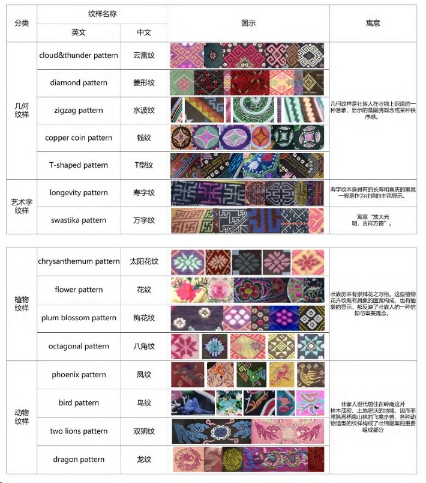

图1 常见壮锦纹样分类及寓意[1]

壮锦的应用

壮锦广泛应用于服饰、家居（被面、床单、围裙、背包等），是壮族节庆（如三月三歌圩）、婚嫁、丧葬等重要场合的必备物品。它不仅是民族身份的标识，更体现了壮族人民的审美情趣与创造力——色彩上大胆运用红、黄、蓝、绿等对比强烈的色调，构图饱满、线条粗犷，洋溢着浓郁的乡土气息和热烈的生命张力。

壮锦纹样创新生成的新纹样效果研究

数据收集与预处理

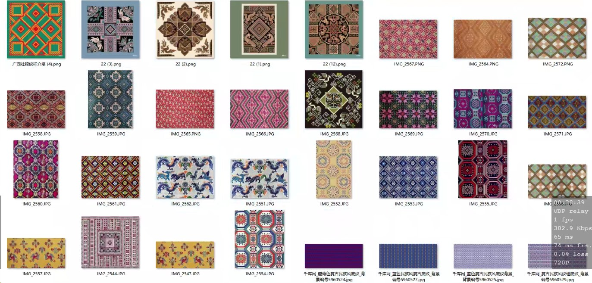

将收集到的约150张纹样图案，涵盖几何纹（62%）、动物纹（23%）、植物纹（15%）三类核心纹样，分辨率≥300DPI。使用OpenCV图像处理工具对数据进行去噪、裁剪、归一化处理，统一尺寸为512×2512像素，并进行分类标注，构建训练数据集，为后续系统开发做数据采集准备。

图2 部分原始数据集

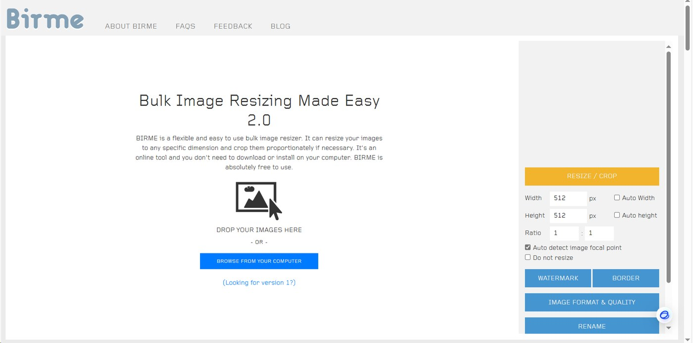

图3 图片批量裁剪网站

模型选择

模型选择：本研究采用 Stable Diffusion 系列的 anythingv5v3 模型，其在纹理生成与细节捕捉中表现优异，适配纹样创新需求，并且使用LoRA进行训练模型。

工具选择：comfyui工作流、SD训练器、controlnet LoRA 、liblib网站平台、Flask、Trae等。

工作流设计

设计ComfyUI 工作流，通常按照“文本/图形prompt输入——潜空间处理——采样生成图像——解码输出图像”的基本逻辑连接节点设计，并调节各节点的参数。得到如下图工作流：

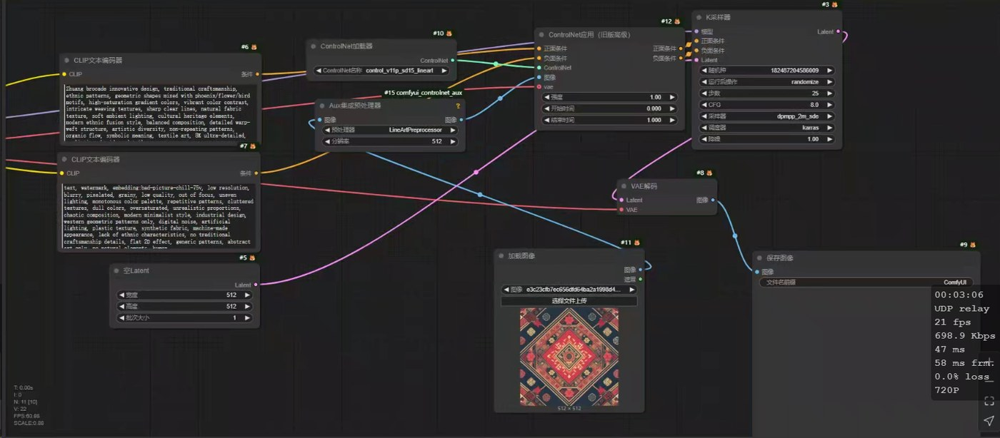

图4：壮锦创意生成纹样创新ComfyUI 工作流

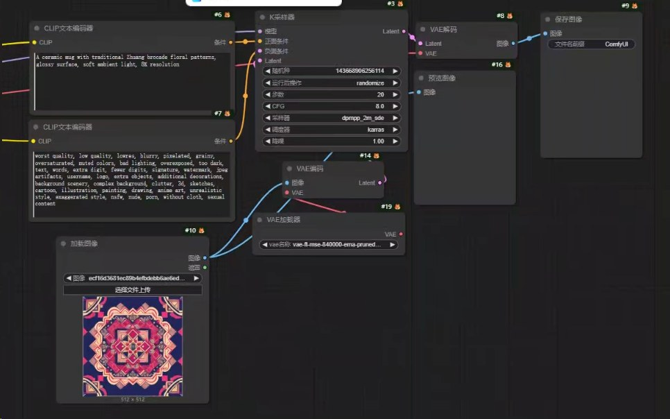

图5：基于创新纹样设计生成文创（图生图）ComfyUI 工作流

控制变量实验与结果分析

在建立图生图工作流的过程中发现，输入的双 CLIP 编码器提示词一致，训练步数对图片生成的风格影响较大。现采用单一变量法探究关键参数影响：

实验设计：实验变量训练步数与指标的关系

**表 2**

| 对照组 | 自变量 | 因变量 | 其他固定参数 |
| --- | --- | --- | --- |
| 训练步数组 | 训练步数 | 新纹样文化保留度、现代审美契合度 | LoRA秩（rank）= 8 学习率 = 1e-4（余弦退火策略） 批量大小（batch size）= 32 |
| 组A | 150步 |  | LoRA秩（rank）= 8 学习率 = 1e-4（余弦退火策略） 批量大小（batch size）= 32 |
| 组B | 500步 |  | LoRA秩（rank）= 8 学习率 = 1e-4（余弦退火策略） 批量大小（batch size）= 32 |
| 组C | 1000步 |  | LoRA秩（rank）= 8 学习率 = 1e-4（余弦退火策略） 批量大小（batch size）= 32 |

评估指标

文化保留度：美术专业教师评分（1-5分），反映传统纹样的符号表达完整性。

现代审美契合度：不同年龄段用户评分（1-5分），反映设计的创新性与当代审美契合度。

综合满意度：文化保留度 × 现代审美契合度的加权平均。

实验数据与分析

**表 3**

| 组别 | 训练步数 | 文化保留度 | 现代审美契合度 | 综合满意度 | 问题诊断 |
| --- | --- | --- | --- | --- | --- |
| 组A | 150 | 4.1 | 3.9 | 4.1 | 欠拟合（与训练集不符） |
| 组B | 500 | 4.5 | 4.3 | 4.4 | 平衡状态（传统与创新兼顾） |
| 组C | 1000 | 4.7 | 4.2 | 4.5 | 过拟合（过度依赖训练数据细节） |

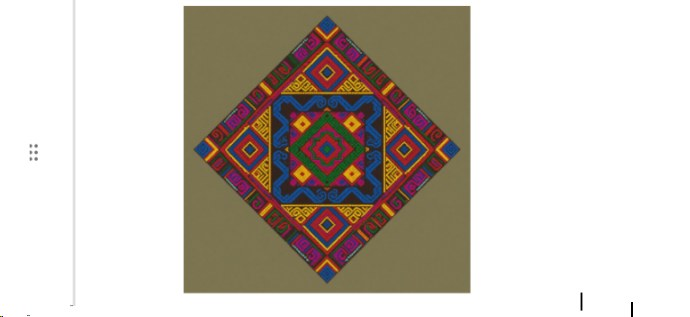

输入原始纹样图

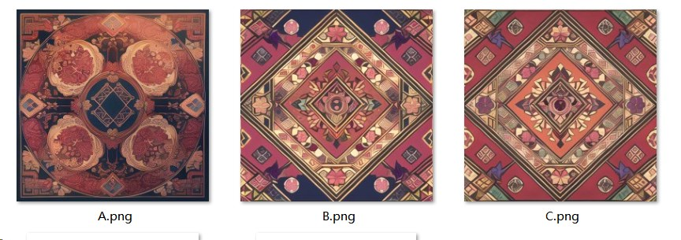

组A、组B、组C对应生成的图片

关键发现

**表 4**

| 组别 | 效果 | 结论 |
| --- | --- | --- |
| 组A（150步） | 文化保留度低：现代审美契合度低：与原始数据集不符合，未能融合当代元素（如渐变色） | 训练步数不足导致欠拟合，模型无法捕捉数据规律。 |
| 组B（500步） | 文化保留度与现代审美契合度均达到平衡：传统纹样的几何结构（如太阳纹的辐射线）被精准还原 | 训练步数适中，实现最佳泛化。 |
| 组C（1000步） | 文化保留度高：设计风格单一，缺乏创新性 | 训练步数过高导致过拟合，泛化能力下降。 |

结论：训练步数的影响

训练步数过低：模型未充分学习数据特征，导致欠拟合（文化保留度与现代审美契合度均低）。

训练步数过高：模型过度拟合训练数据，导致过拟合（文化保留度高但现代审美契合度低）。

训练步数适中：模型在传统与创新之间取得平衡，实现最佳泛化（文化保留度与现代审美契合度均高）。

#### 3.壮锦纹样生成系统开发与功能实现

系统前端采用html语言，后端调用训练完成的模型进行图像生成。用户可点击浏览壮锦文化，并上传原始纹样图片，系统自动生成新纹样并提供下载。同时集成文创产品模板库（如手机壳、帆布包、文具图案），支持一键生成文创产品效果图，提升实用性。

壮锦纹样创新生成系统功能设计

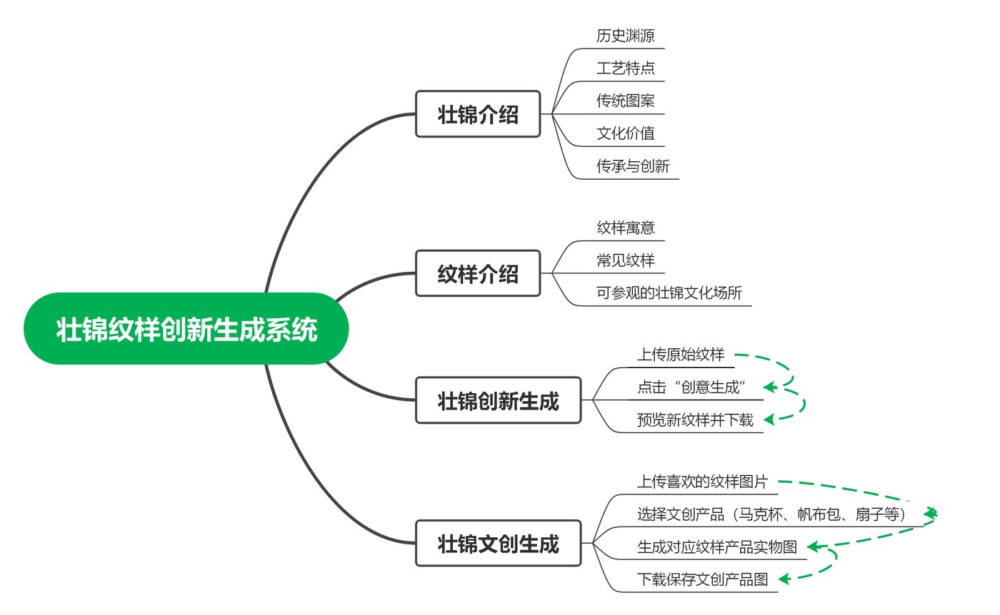

图6 系统功能设计图式

壮锦纹样创新生成系统界面展示

首页展示：该页面具备导航引导、内容展示功能。呈现壮锦文化、工艺与创新应用；能让用户快速了解壮锦价值与创新实践，为探索壮锦设计、定制搭建入口，助力用户感受非遗魅力。

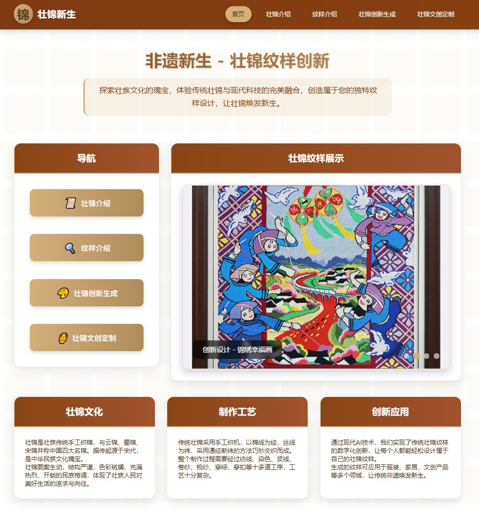

图7 首页展示

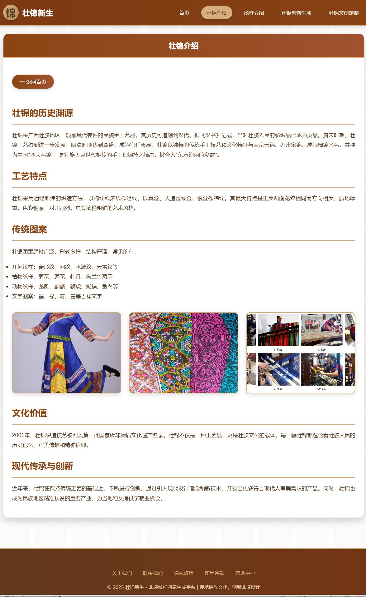

“壮锦介绍”界面：该页面聚焦壮锦，从历史渊源起笔，依次呈现工艺特点、传统图案，阐明其文化价值，还介绍现代传承创新路径，系统梳理壮锦文化脉络 。为用户搭建认知桥梁，既助力了解壮锦历史底蕴与艺术特色，感受文化价值，也能让用户知晓传承新动态，激发对壮锦文化探索、传播热情 。

图7 壮锦介绍

“纹样介绍”界面：该页面聚焦壮锦纹样，通过展示典型纹样及解读寓意，兼具文化科普与内容展示功能；能让用户快速了解壮锦纹样的文化内涵，感受壮族文化魅力，为探索壮锦文化及创新应用筑牢认知根基。

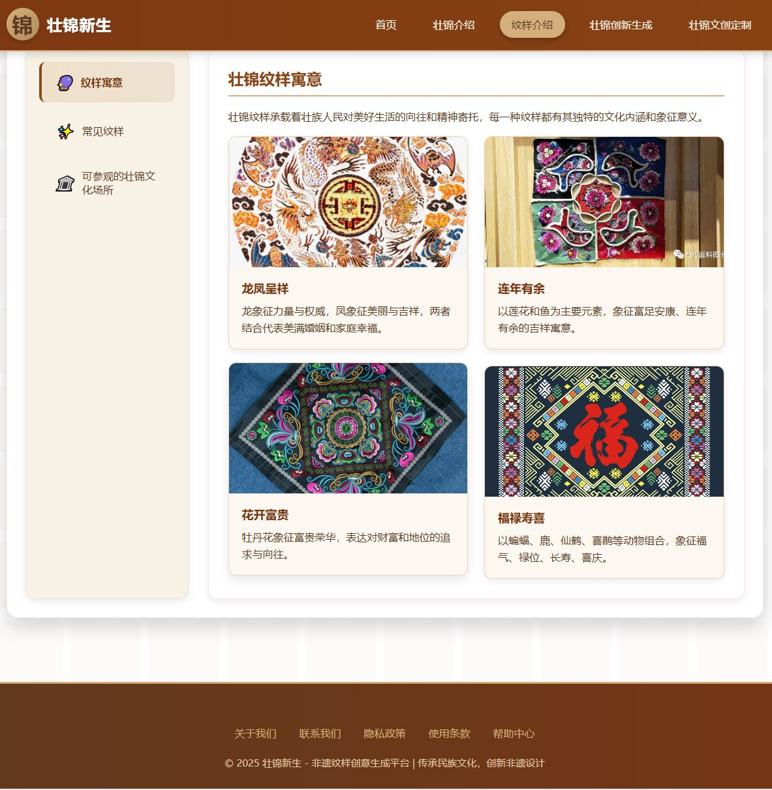

图8 纹样介绍-纹样寓意

“纹样介绍”界面：该页面聚焦壮锦文化场所，系统罗列可参观学习的地点及开放信息，为用户提供实地感受壮锦工艺、深化文化认知的途径，助力搭建线上了解到线下体验的桥梁，推动壮锦文化的亲身感知与传承。

图9 纹样介绍-可参观的壮锦文化场所

“壮锦创新生成”界面：该页面具备上传壮锦纹样图片并基于 AI 进行创意生成的功能，为用户提供非遗纹样创新设计工具；用户可以反复生成，直至达到喜欢的效果。

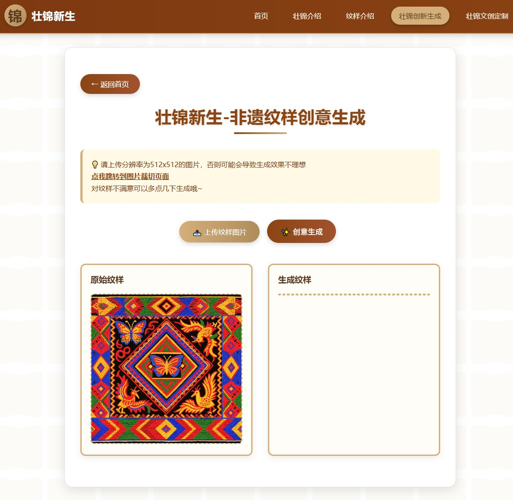

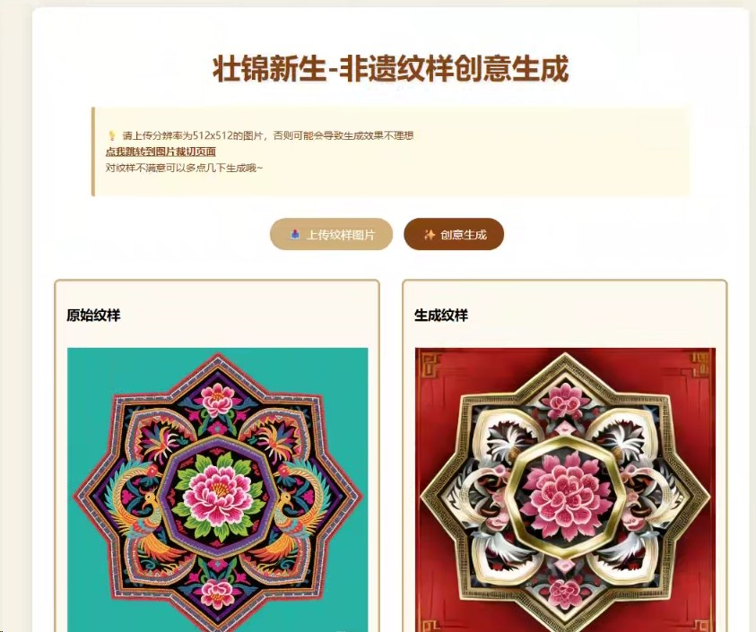

“壮锦文创定制”界面：该页面支持用户上传壮锦纹样、选定文创类型并生成预览，具备个性化定制操作功能；用户可以选择自己喜欢的文创产品，如帆布包、笔、冰箱贴、扇子等，生成专属的壮锦纹样产品。

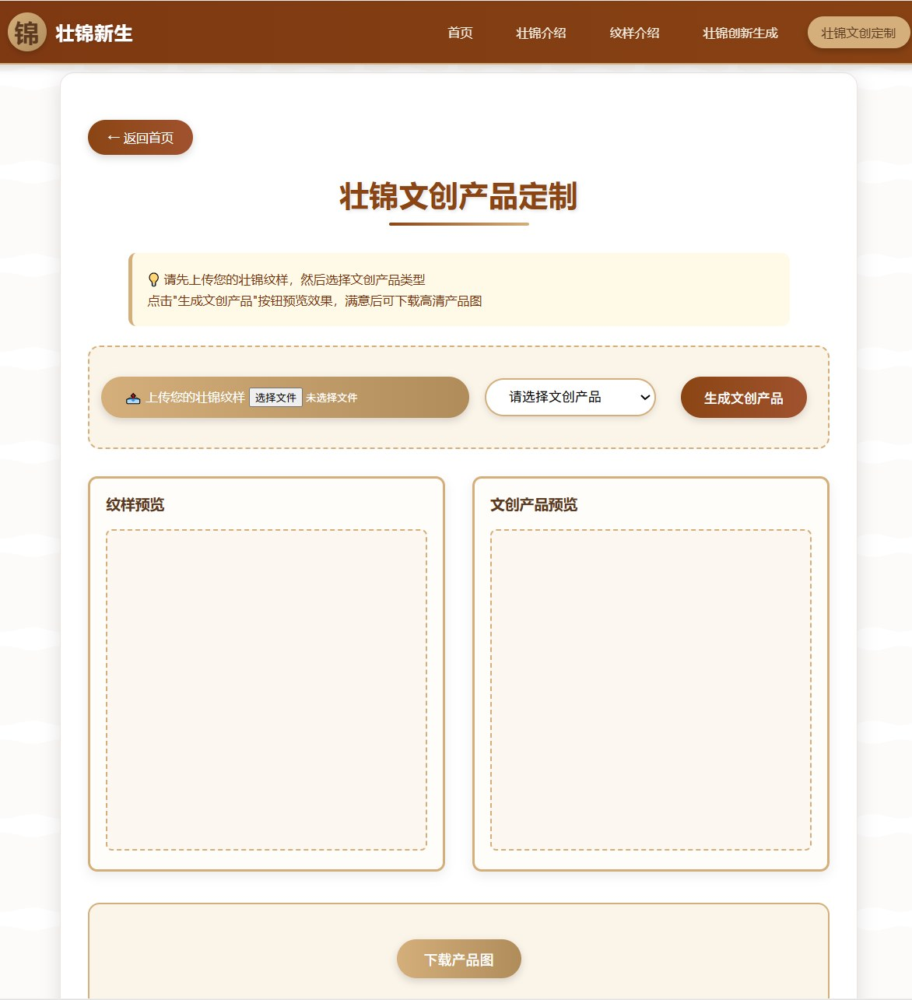

#### 4.系统使用效果评估

样本选择

邀请美术教师、非遗传承人及高中生共30人参与系统试用，收集用户对生成效果、操作体验及文化认同感等方面的评价，用于评估系统的实用性与社会影响。

评估指标

传统韵味与现代美感综合评价（5 级量表：1=完全不符合，5=完全符合）

创新设计灵感价值（仅非遗传承人参与，5 级量表）

**表 5**

| 用户群体 | 样本数 | 传统韵味与现代美感平均得分 | 88% 用户反馈“兼具传统韵味与现代美感” | 创新设计灵感价值（非遗传承人） | 75% 非遗传承人反馈“可作为灵感来源” |
| --- | --- | --- | --- | --- | --- |
| 高中生 | 20 | 4.1（±0.8） | 18/20（90%） | — | — |
| 美术教师 | 5 | 4.5（±0.5） | 4/5（80%） | — | — |
| 非遗传承人 | 5 | 4.2（±0.6） | 4/5（80%） | 4.3（±0.7） | 4/5（80%） |

数据说明：

传统韵味与现代美感：高中生群体对现代感的接受度更高，平均得分为 4.1，但仍有 90% 认为设计“兼具传统与现代”。非遗传承人更注重文化保留度，评分标准更为严格，但仍认可 AI 生成纹样的文化价值。

创新设计灵感价值：非遗传承人中 4 人（80%）明确表示 AI 生成纹样可作为创新设计的参考，尤其是对纹样的色彩渐变和抽象化处理表示认可。

综合分析

用户测试结论

AI 生成纹样在传统与现代之间的平衡性获得广泛认可，尤其是高中生和美术教师群体对创新设计的接受度较高。

非遗传承人对 AI 技术的“辅助设计”价值表示肯定，但建议在生成过程中进一步优化纹样的文化符号表达。

市场验证结论

AI 生成纹样在年轻消费市场中表现优于传统纹样，证明其设计理念符合现代审美趋势。建议通过“传统纹样 + AI 创新”组合策略，兼顾文化深度与市场接受度（如在丝巾设计中保留核心传统图案，仅局部加入渐变色或抽象化处理）。

​

创新点​

### （一）文化与技术融合创新​

将 AI 技术深度融入壮锦文化传承与创新中，实现传统纹样的智能生成和个性化定制，打破传统设计局限，为壮锦文化注入新的活力。通过 AI 算法对壮锦传统纹样的特征进行学习和分析，能够生成既保留传统文化元素又具有现代设计感的新纹样，拓展了壮锦设计的可能性。​

### （二）用户参与式创新​

构建用户共创平台，让用户成为壮锦设计的参与者和创作者，激发用户的创造力和对壮锦文化的兴趣，形成独特的文化传播与消费模式。用户可以在平台上根据自己的喜好对壮锦纹样进行调整和设计，参与到壮锦产品的创作过程中，增强了用户与壮锦文化的互动和情感连接。​

跨学科融合

本研究及其实验采用了信息技术、美术以及地理学科跨学科融合的方法，在不同学科领域中求同存异，确保研究实验的严谨性以及普遍性。跨学科融合还能为研究提供充分而有力的理论支持，多学科融合于壮锦智能生成系统。

LoRA的使用及其训练

本次在试验中涉及到了两次生图的comfyui工作流，都使用了LoRA模型，本次在试验中涉及到了两次生图的comfyui工作流，都使用了LoRA模型，相比较于使用传统的直接微调，LoRA要求数据集要求数量并不多，但是训练效果能达到全参量数据微调的约90%往上，实现降本增效。

### （五）文化符号学驱动的 AI 生成范式

构建基于皮尔斯符号学三元理论的壮锦纹样解析体系，将传统纹样解构为 “客体 - 表征 - 诠释” 三维度特征向量。通过双 CLIP 编码器分别处理正向文化语义（如 “蛙纹 - 生殖崇拜”）与反向干扰过滤（如 “非写实风格”），实现文化符号的可计算性转译。

分析与结论​

### （一）分析​

1.技术应用可行性分析：AI 技术在壮锦纹样创新设计、个性化定制和数字化体验等方面的应用是可行的。通过 AI 算法能够高效地处理和分析壮锦传统纹样数据

2.文化传承与创新分析：非遗壮锦与 AI 技术的结合，为壮锦文化的传承与创新提供了新的途径。AI 技术的应用不仅能够保留壮锦的文化内涵，还能够拓展壮锦的设计空间和应用领域，吸引更多年轻人关注和参与壮锦文化传承。同时，用户参与式创新模式的构建，促进了壮锦文化的传播和发展，形成了良好的文化生态。​

3.产业发展与市场前景分析：基于 AI 技术开发的壮锦设计与定制系统，能够推动壮锦文化产业的升级和发展。通过个性化定制和规模化生产，壮锦产品能够更好地满足市场需求，创造新的经济增长点。同时，数字化体验场景的打造和文化传播渠道的拓展，能够提升壮锦文化的品牌影响力，为壮锦文化产品的市场推广奠定基础。​

### （二）结论​

本研究通过对非遗壮锦与 AI 技术结合的研究，得出以下结论：​

1.AI 技术与非遗壮锦的融合具有重要的理论和实践意义，为非遗文化的创新传承和产业升级提供了新的思路和方法。​

2.利用 AI 技术实现壮锦传统纹样的创新设计、构建个性化定制系统和打造数字化体验场景是可行的，能够有效解决壮锦传承面临的问题，提升壮锦文化的传播力和影响力。​

3.文化与技术的深度融合、用户参与式创新和数字化体验创新是非遗壮锦与 AI 结合的关键创新点，能够为非遗文化的保护与发展提供新的模式和路径。​

4.非遗壮锦与 AI 技术的结合将对文化传承、经济发展和社会生活产生积极的影响，推动壮锦文化在现代社会的可持续发展。​

对社会生产生活产生的影响​

### （一）文化传承方面​

为壮锦文化的传承提供了新的技术手段和传播方式，吸引更多年轻人关注和参与壮锦文化传承，解决传承人才短缺问题。通过数字化记录和展示，确保壮锦文化的历史记忆和传统技艺得以长久保存和传承。AI 技术的应用使得壮锦文化的传承不再局限于传统的师徒相传模式，年轻人可以通过数字化平台学习和了解壮锦文化，参与壮锦的设计和创作，增强了壮锦文化传承的活力和可持续性。​

### （二）经济发展方面​

推动壮锦文化产业升级，开发出多样化的壮锦文化产品，满足市场个性化需求，创造新的经济增长点。促进相关产业链的发展，带动设计、生产、销售、服务等多个行业的就业，为地方经济发展做出贡献。基于 AI 技术的壮锦设计与定制系统能够实现壮锦产品的个性化生产和规模化推广，提高壮锦产品的附加值和市场竞争力，推动壮锦文化产业向高端化、智能化方向发展。​

### （三）社会生活方面​

丰富人们的文化消费选择，让更多人能够接触和体验到壮锦文化的魅力，提升生活品质和文化素养。通过数字化体验和社交分享，增强文化交流与互动，促进不同民族和地区之间的文化融合与理解。AI 技术打造的数字化体验场景为人们提供了更加便捷、丰富的文化消费方式，人们可以随时随地感受壮锦文化的魅力。同时，壮锦文化的传播和推广也促进了不同民族和地区之间的文化交流与合作，增强了文化认同感和民族凝聚力。

结 语

随着人工智能技术的不断发展，以人工智能技术对中华优秀传统文化进行创造性转化和设计创新是当前文化建设的重要手段。本文根据实验结果分析，为用户总结出了应用AI工具非遗纹样创新设计的方法，提出了AI应用于非遗创新设计的策略，由此降低了用户应用AI工具进行非遗创新设计的门槛，为研究探索数字化技术赋能非物质文化遗产传承与创新提供新思路新路径。

参考文献:

张梦雪,基于图像风格迁移的壮锦纹样衍生设计 [D].桂林:桂林电子科技大学,2022.

新华社. 习近平对非物质文化遗产保护工作作出重要指示[ EB∕OL].

(2022-12-12) [2023-12-15]. https:∕∕ www. gov. cn∕xinwen∕2022-12∕12∕content_

#### 5731508. htm.

Xinhua News Agency. XI Jinping gives import instructions on the protection of

intangible cultural heritiage [ EB∕OL]. (2022-12-12) [2023-12-15]. https:∕∕

www. gov. cn∕xinwen∕2022-12∕12contebt_5731508. htm.

[2]习近平. 把中国文明历史研究引向深入增强历史自觉坚定文化自信[ J].

中国民政, 2022(14): 4-6.

XI J P. Guiding in-depth research on the history of Chinese civilization,

enchancing historical awareness and strengthening cultural confidence [ J ].

China Civil Affairs, 2022(14): 4-6

[3]Zhang, A., et al. (2023). ControlNet: Adding Conditional Control to Text-to-Image Diffusion Models. arXiv preprint arXiv:2302.05543.

[4]Hu, E. H., et al. (2021). Lora: Low-Rank Adaptation of Large Language Models. arXiv preprint arXiv:2106.09685.

[5]黄晓霞。壮锦纹样的数字化传承与创新设计研究 [J]. 装饰，2020 (5):124-125.

[6] Radford, A., et al. (2021). Learning Transferable Visual Models From Natural Language Supervision. International Journal of Computer Vision, 129(7):1873-1892.

[7] 胡鸿，高士明，赵静，等. AI 应用于苗绣非遗创新设计的特点及策略研究 [J]. 丝绸，2025, 62 (3): 21-35.

[8] RADFORD A, METZ L, CHINTALA S. Learning Transferable Visual Models From Natural Language Supervision[J]. arXiv preprint arXiv:2103.00020, 2021.

[9] PEIRCE C S. The Collected Papers of Charles Sanders Peirce[M]. Cambridge: Harvard University Press, 1931.

[10] RAHAMAN G M A, PARKKINEN J, HAUTA-KASARI M. A novel approach to using spectral imaging to classify dyes in colored fibers[J]. Sensors, 2020, 20(16): 4379.

[11]Zhang, Y., et al. ControlNet: Adding Conditional Control to Text-to-Image Diffusion Models[J]. 	ICCV, 2023.

[12]习近平。数字化赋能非物质文化遗产传承保护 [J]. 求是，2025 (8): 4-12.

附录

问卷调查报告
